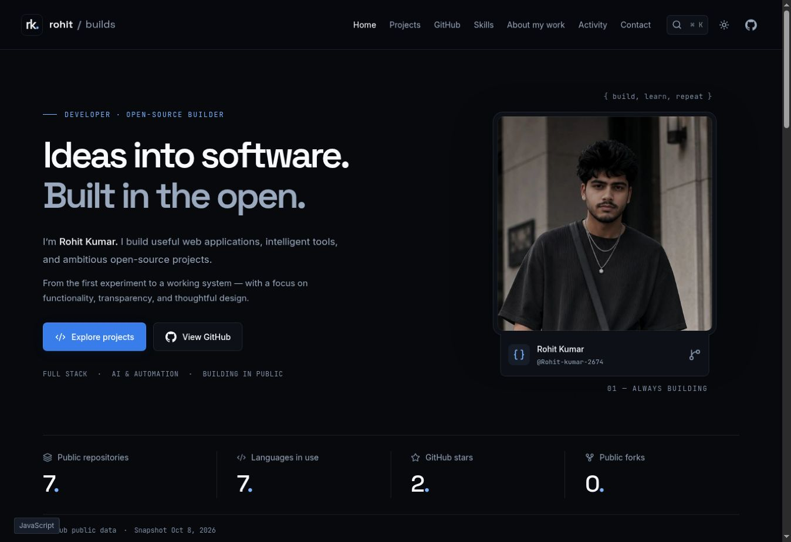

# Rohit / builds

**Useful software. Built in the open.**

A work-focused developer portfolio for [Rohit Kumar](https://github.com/Rohit-kumar-2674), built around public repositories and traceable GitHub data.

[](https://rohit-kumar-2674.github.io/developer-portfolio/)
[](https://github.com/Rohit-kumar-2674/developer-portfolio/actions/workflows/deploy.yml)
[](LICENSE)



## Explore

- Dark and light themes, an original-color cropped portrait, responsive layouts, and reduced-motion support.
- Searchable project explorer with category and technology filters, six sort modes, and grid/list views.
- Pre-rendered project pages with public README content, real screenshots when available, releases, metadata, and source links.
- Public GitHub dashboard: stars, forks, language bytes, recent pushes, event feed, and creation timeline.
- Keyboard command palette (`Ctrl/Cmd + K`) and a small interactive terminal.
- Daily GitHub data refresh, automatic GitHub Pages publishing, and explicit API error states.
- Self-hosted fonts, optimized WebP assets, per-page SEO, sitemap, structured data, and social previews.

## Stack

React · TypeScript · Vite · Tailwind CSS · React Router · Lucide · react-markdown

Charts use accessible SVG and adjacent numeric labels. Animations use CSS. There is no chart or animation framework to download.

## Run locally

Use Node.js **22.12+** (Node 24 recommended) and npm.

```sh
git clone https://github.com/Rohit-kumar-2674/developer-portfolio.git
cd developer-portfolio
npm install
npm run dev
```

Open the URL printed by Vite. `npm ci` is recommended for reproducible installs.

| Command | Purpose |
| --- | --- |
| `npm run dev` | Development server |
| `npm run build` | Typecheck, bundle, pre-render all public routes |
| `npm run preview` | Serve the production output |
| `npm run lint` | ESLint |
| `npm run typecheck` | Strict TypeScript validation |
| `npm test` | Privacy, normalization, search, and API failure tests |
| `npm run sync` | Refresh GitHub data |
| `npm run validate` | Complete code-quality and build checks |

## Architecture

```text
src/
  components/      Shared UI, project cards, chart, command palette
  pages/           Home, explorer, repository detail, GitHub, privacy
  data/            Allowlisted public GitHub snapshot
  lib/             GitHub REST client and project helpers
  types/           Data contracts
  styles/          Responsive design tokens and CSS
scripts/
  sync-github.ts   Public-only API collection and fallback handling
  normalize.ts     Field allowlisting and technology evidence
  prerender.tsx    Static HTML, metadata, sitemap, manifest
public/            Original-color portrait crops and project screenshots
.github/workflows/ CI, deployment, daily refresh
```

## GitHub data and limitations

The official REST API is the only metadata source. The public `/users/{username}/repos` endpoint is paginated and filtered again for public, owned repositories. Private repositories are rejected by normalization. Fields such as profile email, address, and location are never collected for display.

Technology tags come from GitHub language statistics, selected package manifests, and workflow files. Category assignment is a documented keyword heuristic. Featured summaries are editorial descriptions grounded in the repositories' README files; they do not assert independently verified production readiness. `scripts/normalize.ts` contains the selection.

- Language percentages measure code bytes, **not skill or experience**.
- Watchers use `subscribers_count`, never GitHub's misleading `watchers_count` star alias.
- GitHub's `open_issues_count` includes pull requests; the UI labels it accordingly.
- Public event data is a limited and potentially delayed window, not a complete contribution calendar.
- A live demo is shown only after an owner-controlled GitHub Pages URL responds successfully during sync. Other homepages remain metadata, not verified deployments.
- Missing information stays unavailable; no statistics or events are invented.
- On a core API failure, the previously committed, dated public snapshot is retained with an unavailable notice. Optional endpoint failures are labeled on project pages. Updates to repository visibility appear after the next successful sync.
- The browser's “Check live totals” operation is token-free and reports fresh totals separately from the build snapshot.

### Automatic refresh

`refresh-github.yml` runs at **03:23 UTC daily**, invoking the reusable deployment workflow. It refreshes metadata, validates, builds, and deploys without creating timestamp-only commits. GitHub may delay schedules or disable them after extended repository inactivity. The initial committed snapshot is an offline fallback; scheduled snapshots are published as build artifacts rather than committed to source.

### Credentials

CI injects `${{ secrets.GITHUB_TOKEN }}` only into the sync step. Never use a `VITE_` prefix for credentials. The frontend contains no token. `.env.example` lists only non-secret configuration.

## GitHub Pages deployment

1. Open repository **Settings → Pages** and set **Source → GitHub Actions**.
2. Push to `main` or run **Deploy portfolio** manually.
3. The workflow validates, syncs, builds, uploads, and deploys `dist/`.

`actions/configure-pages` supplies the base path and public URL. Static HTML is generated for every project, so direct links and refreshes work on Pages without a redirect hack. Unknown paths use a real `404.html`.

To build for the project path locally:

```sh
BASE_PATH=/developer-portfolio/ SITE_URL=https://rohit-kumar-2674.github.io/developer-portfolio npm run build
```

If you fork or rename the project, update the username, branding, curated descriptions, and constants in `src/lib/projects.ts` as well as the workflow username. The portrait is not a reusable template asset.

## Privacy

Work-related public information only. No personal contact details, private repositories, trackers, login forms, or marketing cookies. Local storage remembers theme preference. External README images and live GitHub checks make standard network requests. See the [privacy page](https://rohit-kumar-2674.github.io/developer-portfolio/privacy/) and [asset provenance](docs/ASSETS.md).

## Quality

See [verification notes](docs/VERIFICATION.md) for the checks actually performed. Lighthouse 95+ scores are a target, not a claim until measured on the deployed build.

## License

Website source code: [MIT](LICENSE). The personal portrait and identity are excluded. Project screenshots retain their respective source licenses. Font licenses are included in their npm packages. The GitHub mark is from Simple Icons (CC0); Lucide icons use ISC.
